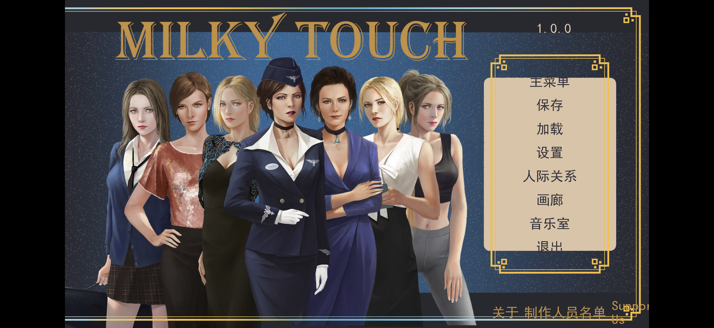

# renpy_ios —— 把 PC 版 Ren'Py 游戏打成 iOS 的未签名 .ipa

用官方 Ren'Py SDK + 官方 renios DLC，在 macOS 上把游戏编成 `.app`，再装进
`Payload/` 打成 `.ipa`，**全程不签名**。产物交给 SideStore / AltStore /
Sideloadly / LiveContainer 自己签。

先说清楚一件事：**iOS 没有真正"免签"这回事**。任何 app 要在 iPhone/iPad 上跑，
都得有一份有效的签名。这里说的"不签名"是指：

* 构建时不需要 Apple 开发者账号、不要证书、不要 provisioning profile（
  `CODE_SIGNING_ALLOWED=NO`），谁都能在 GitHub Actions 上免费跑；
* 装到设备上时，由**你自己**用免费 Apple ID 证书现场签（SideStore / AltStore /
  Sideloadly），或者用 LiveContainer 让多个 app 共用同一份签名。

免费证书 7 天过期，到期重新签一次即可（存档不丢）。

---

## 目录结构

```
scripts/
  zz_ios_patch.rpy     运行期补丁：把 Documents/game* 插进 Ren'Py 的 searchpath
  patch_game.py        把游戏 game/ 组装成 ios_create 能吃的项目 + 生成构建规则
  fix_project.py       改 Info.plist（文件 App 可见性 / bundle id / 显示名）、清签名配置
  build_ios_ipa.sh     macOS 上：ios_create → xcodebuild → 组 Payload → .ipa
tools/
  make_payload.py      把 ipa 里剔除的图片/音频/.rpa 打成外置素材 zip（可多卷）
  sync_game_source.py  从 PC 版游戏目录里挑出「该进 git 的小文件」同步到 games/
games/
  <Game>/game/         游戏脚本 + 字体 + 翻译（几十 MB，进 git）
.github/workflows/
  build-ios.yml        云端打包（macOS runner）
```

`renpy_ios` 只放**代码和脚本**。图片/音频/`.rpa` 这些几百 MB 到几 GB 的素材
不进仓库，走「外置素材包」：打成 zip 放到 GitHub Release，你在 iPad 上用
「文件」App 下载解压，拖进 app 的 `Documents/game/`。

为什么这么做：`archive.rpa` 一个文件就 1.3GB，git 管不了；而自签工具对包体积
很敏感。ipa 只有 60MB 左右时，装起来、重签起来都轻松得多。

---

## 一、把游戏脚本放进仓库

在本机（Windows 就行）跑：

```powershell
python tools/sync_game_source.py `
  --game "D:\path\to\MilkyTouch\game" `
  --out  "games\MilkyTouch\game" `
  --clean
```

它会挑出这些进 git：

| 收 | 不收 |
| --- | --- |
| `*.rpy` / `*.rpyc` / `*.rpymc` 脚本 | `*.rpa`（→ 外置素材） |
| `gui/**`（UI 图 + 字体） | `images/**`、`audio/**`、`videos/**`（→ 外置素材） |
| `tl/**`（翻译） | `saves/`、`cache/` |
| `files/**`（MilkyTouch 的 .rpyc 藏在这） | 视频（`.webm/.mp4/...`） |
| `presplash.*`、`icon.*`、字体 | |

还有一条规则：**同名 `.rpyc` 存在时，丢掉那个 `.rpy`**。很多压缩版/汉化版里
的 `.rpy` 是 unrpyc 反编译出来的残次品（MilfyCity 的 `scripts/rps.rpy:347`
就是 `show paper_selection:` 后面跟空块，一编译就报
`show statement expects a non-empty block`），而 `.rpyc` 才是玩家实际跑的
字节码。原版目录里 `.rpyc` 的 mtime 永远比 `.rpy` 新，所以游戏一直用的是
`.rpyc`；两个都留着，git checkout 的 mtime 又不可靠，会随机选中坏源码。

目前仓库里已经有：

* `games/MilkyTouch/game` —— 132 个文件 / 52 MB
* `games/MilfyCity/game` —— 1492 个文件 / 35 MB

---

## 二、打包 ipa

### 方式 A：GitHub Actions（推荐，不用自己有 Mac）

1. push 到 GitHub；
2. 仓库页面 → **Actions** → 左边选 **Build unsigned iOS IPA** → **Run workflow**；
3. 参数：
   * `game`：`MilkyTouch` 或 `MilfyCity`
   * `renpy_version`：`7.7.3`（默认，已验证）
   * `split_assets`：`true`（外置素材，ipa 只有 ~60MB）
   * `display_name`：图标下的名字，例如 `Milky Touch`
   * `bundle_id`：留空则 `com.domain.<Game>`，建议自己定一个，例如
     `com.julyfinal.milkytouch`（重装/升级要靠它认人）
* `assets_tag`：素材 Release 的 tag。**MilfyCity 必填**（原因见下），
     MilkyTouch 留空即可
4. 跑完在 **Artifacts** 里下 `<Game>-ipa-unsigned`，里面有 `.ipa` 和 `.sha256`。

workflow 干的事：下 `renpy-7.7.3-sdk.zip` 和 `renpy-7.7.3-renios.zip`
（renios 是**独立 DLC**，必须解到 `<SDK>/renios`）→ `patch_game.py` → 在 SDK
目录里 `renpy.sh launcher ios_create` → `fix_project.py` → `xcodebuild
CODE_SIGNING_ALLOWED=NO` → 组 `Payload/` 打 zip。

整轮大约 10 分钟（MilkyTouch 完全不下载素材）。

#### 如果 Actions 排不到 macOS runner

GitHub 托管的 macOS runner 不是所有账号都有。两个典型症状：

* 一两秒就 cancelled，注解写
  `The configuration 'macos-14-arm64-us-default' is not supported`；
* 一直 `queued`，`runner_id` 始终是 0，几十分钟都没人领。

两种绕法：

* **自建 runner**：找一台 Mac，装 GitHub Actions runner 并打上标签（例如
  `my-mac`），然后 Run workflow 时把 `runner` 参数填成 `my-mac`；
* **干脆不用 Actions**：直接在任意一台 Mac 上跑方式 B，脚本完全一样。

#### 为什么 MilkyTouch 不用给素材，MilfyCity 必须给

MilkyTouch 的脚本全是 `.rpyc`，构建期 Ren'Py 只做字节码转换，**不读任何图片**，
所以纯源码就能出 ipa。

MilfyCity 在 `init` 里就调 `renpy.image_size()`：

```
game/scripts/gui/computer/scenes_gallery/scenes_gallery_setup.rpy:4   MaxScale2()
game/scripts/gui/computer/scenes_gallery/scenes_gallery_images.rpy:4  <- 在 init python 里调用
```

项目里没有 `images/secret_gallery/Scenes/1.png` 就直接

```
IOError: Couldn't find file 'images/secret_gallery/Scenes/1.png'.
```

`ios_create` 取不到 dump，整轮失败。所以 CI 会把素材 zip 解到临时目录，再用
`--media` 把它挂进 Ren'Py 的 searchpath（走 `RENPY_IOS_GAME_DIR` 环境变量 →
`zz_ios_patch.rpy`）。**这些素材不会进 base/**，ipa 依然只有 51MB，运行时还是
靠 iPad 上的 `Documents/game/`。

### 方式 B：本地 macOS

```bash
export SDL_VIDEODRIVER=dummy SDL_AUDIODRIVER=dummy
python3 scripts/patch_game.py \
    --sdk ~/renpy-7.7.3-sdk \
    --game games/MilkyTouch/game \
    --out  work/MilkyTouch \
    --name MilkyTouch --display-name "Milky Touch" --version 1.0.0

bash scripts/build_ios_ipa.sh \
    --sdk ~/renpy-7.7.3-sdk \
    --project work/MilkyTouch \
    --out dist \
    --display-name "Milky Touch" \
    --bundle-id com.julyfinal.milkytouch
```

MilfyCity 要额外加 `--media /path/to/解压出来的/game`（可以给多个）：

```bash
bash scripts/build_ios_ipa.sh ... \
    --media ~/assets/MilfyCity/game --media ~/assets/MilfyCity/game_part2
```

> `ios_create` / `ios_populate` 本身在 Windows / Linux 上也能跑，只有
> `xcodebuild` 那一步必须 macOS。所以本机上可以先跑到 `work/` + Xcode 工程，
> 再拿到 Mac 上编。

---

## 三、生成外置素材包（本机跑，一次性）

```powershell
python tools\make_payload.py `
  --game "D:\path\to\MilkyTouch\game" `
  --out  dist\payload
```

产出：

```
dist/payload/assets.part1.zip   ->  解压出 game/          （archive.rpa，约 1.3GB）
dist/payload/assets.part2.zip   ->  解压出 game_part2/    （audio + images，约 1.3GB）
dist/payload/assets-manifest.json
```

为什么分卷：**GitHub Release 单个附件上限 2 GiB**，而 MilkyTouch 的素材有
2.58GB。也不能用 `.tar.zst` —— iPad 的「文件」App 只认 `.zip`。

为什么每卷用不同的顶层目录：iOS 上合并两个同名目录极其难操作。`part1` 解出
`game/`，`part2` 解出 `game_part2/`，两者**并排放在 Documents 下**即可，
`zz_ios_patch.rpy` 会把 `Documents` 下所有以 `game` 开头的目录都加进 searchpath。

然后把 `dist/payload/*.zip` 上传到 GitHub Release（随便一个 tag，比如
`assets-MilkyTouch`）。

---

## 四、装到 iPhone / iPad 上

### 4.1 安装 ipa

任选一个：

* **SideStore**（推荐，设备上直接签，7 天自动续签）
* **AltStore**（同上，需要电脑跑 AltServer）
* **Sideloadly /爱思**（电脑上签好再装）
* **LiveContainer**（一份签名装多个 app，适合同时装两个游戏）

因为 ipa 是未签名的，直接双击装是不行的，必须过这些工具。

已经打好的包放在 Release：

* `milkytouch-1.0.1` → `MilkyTouch.ipa`（58 MB，不含素材，含显示兜底补丁）
* `milkytouch-1.0.0` → 首个可用版本（同样不含素材，但没有横屏兜底）
* `milkytouch-diag1` / `diag2` → 排查显示问题时的诊断包，可以忽略

**LiveContainer 用户必须先看 4.1.2**（不改朝向锁，画面只会显示左上角一条）。

### 4.1.1 放素材的另一种办法（比走网络快）

`UIFileSharingEnabled` 打开之后，用数据线接电脑：

* **Finder**（macOS 10.15+）：选设备 → 文件 → 找到 app → 直接把 `game`
  文件夹拖进去；
* **Windows**：装 Apple Devices 或 iTunes，同样在「文件共享」里拖；
* **SideStore/AltStore 安装的 app 都支持这个**；LiveContainer 里的 app
  数据在 LiveContainer 自己的容器里，Finder 看不到，得走 4.2 的 zip 路线。

### 4.1.2 LiveContainer 用户必读：把这个 app 的「朝向锁」改成横屏

**这是唯一必须手动改的 LiveContainer 设置，不改就会「只有左上角一条画面」。**

LiveContainer → 长按 MilkyTouch / MilfyCity → Settings（齿轮）→
**Orientation Lock / 朝向锁** → 选 **Landscape（横屏）** → 关掉 app 重新打开。

原因（详见坑 12）：Ren'Py 的 iOS 后端是 SDL2，它建窗口时要问系统「现在是不是横屏」。
LiveContainer 默认 `LCOrientationLock = Disabled`，此时它没有把宿主的 scene 朝向
改掉，SDL 拿到的窗口是竖屏 420x912 点（帧缓冲 1260x2736），而屏幕是横屏
2736x1260 —— 于是 glViewport 只覆盖屏幕左上角一条 1260x246 的带子。

设成 Landscape 后 LiveContainer 会 swizzle
`UIViewController.__supportedInterfaceOrientations` 等三个方法并强制
`interfaceOrientation = UIInterfaceOrientationLandscapeRight`，SDL 立刻拿到
横屏 912x420 点 / 2736x1260 像素，`drawable_viewport = (249, 0, 2238, 1260)`，
画面正常铺满（1920x1080 内容等比缩放，左右各 249 像素黑边，正常现象）。

用 SideStore / AltStore / Sideloadly 装的不需要这一步（app 用自己 plist 里
声明的横屏方向）。

设好之后应该是这样（iPhone Air，2736x1260 屏幕，1920x1080 内容等比铺满高度，
左右各 249 像素黑边，属正常）：



### 4.2 放素材

1. 在 iPad 上把 Release 里的 `assets.part1.zip`、`assets.part2.zip` 下载下来
   （「文件」App 里点 zip → 自动解压成同名文件夹）；
2. 打开「文件」App → **我的 iPad**（或"我的 iPhone"）→ 找到游戏名字的目录
   （就是 app 的 Documents，名字等于 app 的显示名）；
3. 把解压出来的 `game` 和 `game_part2` 两个文件夹整个拖进去；
4. 启动游戏。

第一次启动时看日志应该能看到：

```
[renpy-ios] external game dir: /var/mobile/Containers/.../Documents/game, .../Documents/game_part2
[renpy-ios] external archives: archive
```

看不到这两行、或者游戏黑屏，多半是素材没放对位置（见下面 FAQ）。

`UIFileSharingEnabled` + `LSSupportsOpeningDocumentsInPlace` 是
`fix_project.py` 写进 Info.plist 的，没有这两个开关，「文件」App 里根本看不到
app 的 Documents。

---

## 五、已知坑（都是踩过的）

### 1. `.rpyc` 魔数被改成 `RENPY RPC3`

有些"整合版/反破解版"游戏把 `renpy/script.py` 里的
`RPYC2_HEADER = b"RENPY RPC2"` 改成了 `RENPY RPC3`（常量名不变，只换字面量，
目的是让 unrpyc 解析失败）。官方 SDK 只认 RPC2，于是报：

```
Exception: Could not load file .../game/files/Characters.rpyc
```

`patch_game.py` 里的 `normalize_rpyc_headers()` 会把每个 `.rpyc` 前 10 个字节
改回 RPC2。**因为字节码载荷本身没变**（MilkyTouch 自带的 `renpy/script.py` 和
官方 7.7.3 的逐字节只差这一行），改头是安全的。

### 2. `config.name` 被游戏自己覆盖

`ios_create` 用 dump 出来的 `config.name` 当 Xcode **target 名和 PRODUCT_NAME**。
MilkyTouch 自己在 `options.rpyc` 里写 `config.name = "Milky Touch"`（带空格），
会让 `xcodebuild -target` 很难写。

解：`zz_ios_build.rpy` 里在 `init 999` 再设一次（main.py 是在 init 代码跑完后
才调 `renpy.dump.dump()`，所以 999 仍然生效），目标名统一成干净的 ASCII。

### 3. 游戏自带的 `.rpa` 默认**会**被打进包

`renpy/common/00build.rpy` 里那条 `("**.rpa", None)` 属于 `renpy_patterns`，
只作用于 SDK 自己的 `renpy/` 目录，**不作用于游戏 `game/` 里的 .rpa**。实测
MilkyTouch 的 1.32GB `archive.rpa` 原样进了 `base/`。split 模式必须自己

```python
build.classify("**.rpa", None)
```

（已经在 `zz_ios_build.rpy` 模板里了。）

### 4. `xcodebuild` 只能用 `-target`，不能 `-scheme`

renios 生成的 `prototype.xcodeproj` 里**只有 project.pbxproj，没有任何 shared
scheme**。`-scheme` 一定失败。

### 5. SDK 版本和游戏不一致

MilkyTouch 是 7.7.3.24061702 打包的，但 `script_version.txt` 写的是 `(7,4,4)`。
`patch_game.py` 会警告但不拦。至今实测能跑；真报字节码错误的话，换对应版本的
SDK（`renpy_version` 参数）再试。

### 6. `.webm` 视频

renios 的 prototype 里带了完整 ffmpeg 静态库（libavformat/libavcodec/...），
所以 Ren'Py 自己的播放器**未必**放不了 webm。但这一点**没有实测过**。
MilfyCity 有 1022 个 `.webm`，真机上如果视频黑屏，优先怀疑这里。

### 7. 中文 / 字体

中文字体在 `game/gui/fonts/`（MilkyTouch 的 `TCM.TTF`/`TCB.TTF` 各 9.3MB），
属于"留在 ipa 里"的保留项。如果启动后满屏方块，说明字体没进包 —— 检查
`zz_ios_build.rpy` 里 `game/gui/**` 那条保留规则有没有被后面的排除规则抢先命中
（`build.classify` 是**首条命中生效**）。

### 8. 有的游戏在 `init` 里就读图片

MilfyCity 的 `scripts/gui/computer/scenes_gallery/scenes_gallery_setup.rpy` 定义了
`MaxScale2()`，而 `scenes_gallery_images.rpy:4` 在 `init python` 里对一堆图片调它。
构建项目里没有那些图，`renpy.image_size()` 直接抛 `IOError`，`ios_create` 因此
拿不到 dump（报错是好几步之外的 `Launching the project failed.` + `error: Invalid
window`，真实原因藏在子进程输出里，见坑 9）。

解法就是 `--media`：把外置素材目录通过 `RENPY_IOS_GAME_DIR` 临时塞进
`config.searchpath`，dump 完它就不参与了，`base/` 里不会有这些文件。

### 9. `ios_create` 失败时的报错会骗人

真实报错在 launcher 弹出的错误对话框里，而 dummy 视频驱动画不出对话框，
于是只剩一句

```
error: Invalid window
```

真正的原因要自己重跑子进程才看得见：

```bash
cd "$SDK" && SDL_VIDEODRIVER=dummy SDL_AUDIODRIVER=dummy ./renpy.sh <PROJECT> quit
```

（`renpy.sh` 在 macOS 上，Windows 上换成 `renpy.exe`。）

### 10. `ld: library 'python3.9' not found`

renios 自带的 `prototype.xcodeproj` 里，Debug 配置写的是 `-lpython2.7`，
Release 配置却写成 `-lpython3.9`，而 `prototype/prebuilt/{release,debug}/`
里只有 `libpython2.7.a`（Ren'Py 7.x 是 Python 2.7）。所以 Release 链接必挂。

`fix_project.py` 已经在处理：它扫 `prebuilt/release` 里真实存在的
`libpythonX.Y.a`，把 pbxproj 里所有 `-lpythonX.Y` 统一成那个名字。

### 11. `The Xcode project already exists. Would you like to rename...`

`ios_create` 的目标目录只要已存在就会问这句话，无头环境里 `input()` 直接
`EOFError`。所以 `build_ios_ipa.sh` 里 `rm -rf dist/xcode` 之后**不能**再
`mkdir dist/xcode`——让 `ios_create` 自己建。

### 12. iOS 上画面挤在左上角 / 只看到左侧一条（LiveContainer）

症状：在 LiveContainer 里启动游戏，画面内容只出现在**左上角**（或左侧约 45%），
其余全黑；但游戏是活的，按钮点得到。

真因（一路查下来的完整链条，**不要**再往 Ren'Py 的数字上找问题）：

1. Ren'Py 的 iOS 显示后端是 SDL2。`gl2draw.pyx` 用
   `pygame.display.set_mode((0,0), WINDOW_FULLSCREEN_DESKTOP|...)` 建窗口；
2. SDL 的 `UIKit_CreateWindow` 注释写明 "ignore the size user requested, and make
   a fullscreen window"，真正的尺寸来自
   `SDL_uikitvideo.m: UIKit_ComputeViewFrame()`：
   `frame = screen.bounds`，`landscape = IsLandscape(statusBarOrientation) ||
   !(supported_orientations & (Portrait|PortraitUpsideDown))`，
   只有 `fullscreen && (landscape != (frame 宽 > 高))` 时才交换宽高；
3. `UIKit_GetSupportedOrientations()`（`SDL_uikitwindow.m:418-481`）先取
   `validOrientations`（app delegate 的 `application:supportedInterfaceOrientationsForWindow:`
   或主 bundle 的 plist），再读 hint `SDL_IOS_ORIENTATIONS`，最后
   **`if ((valid & mask) == 0) mask = valid`** —— 交集为空就回退成 app 支持的；
4. iOS 27 上 `UIApplication.statusBarOrientation` 已废弃且恒为 portrait；
   LiveContainer 默认 `LCOrientationLock = Disabled` 时，宿主 scene 是竖屏 →
   `frame` 是竖屏 420x912 点，`landscape = false` → 不交换 → 窗口/帧缓冲是
   1260x2736（竖屏）；
5. Ren'Py 按 `(420, 912)` 算布局：`ratio = min(420/1920, 912/1080)`，
   `physical_box = (0, 338, 420, 236)`，`draw_per_phys = 1260/420 = 3`，
   于是 `glViewport(0, 1014, 1260, 708)` —— 只覆盖屏幕 y=1014..1260 一条
   1260x246 的带子，正是肉眼看到的「左上角一条」。

实测数据（`zz_ios_probe.rpy` 写到 `Documents/iosdiag_log.txt`）：

```
# 坏的时候：raw 值是竖屏
raw.pg_get_size = (420, 912)      raw.pg_drawable = (1260, 2736)
draw.physical_box = (0.0, 338.0, 420, 236)
draw.drawable_viewport = (0.0, 1014.0, 1260.0, 708.0)

# 修好之后：SDL 自己就是横屏
raw.pg_get_size = (912, 420)      raw.pg_drawable = (2736, 1260)
draw.physical_box = (83.0, 0.0, 746, 420)
draw.drawable_viewport = (249.0, 0.0, 2238.0, 1260.0)   # 2736x1260 屏幕里铺满高度
```

修法：**把 LiveContainer 里这个 app 的 Orientation Lock 设成 Landscape**
（见 4.1.2）。也可以直接改装置上的
`Documents/Applications/<bundleid>.app/LCAppInfo.plist` 的
`LCOrientationLock`（枚举：`Disabled = 0`、`Landscape = 1`、`Portrait = 2`，
见 LiveContainer 源码 `LiveContainerSwiftUI/Models/LCAppInfo.h`；
`TweakLoader/UIKit+GuestHooks.m` 的 constructor 会读它并 swizzle
`__supportedInterfaceOrientations` / `shouldAutorotateToInterfaceOrientation:` /
`UIWindow setAutorotates:forceUpdateInterfaceOrientation:`，以及
`FBSSceneParameters initWithXPCDictionary:` 里强制
`settings.interfaceOrientation`）。

`zz_ios_patch.rpy` 里另外做了两层**兜底**（在 LC 设置正确时都不触发）：
设 `os.environ["SDL_IOS_ORIENTATIONS"] = "LandscapeLeft LandscapeRight"`
（可用 `RENPY_IOS_ORIENTATIONS` 覆盖，`none` 关闭），以及把
`pygame_sdl2.display.get_size` / `get_drawable_size` 在「上报竖屏」时交换宽高。
兜底只能把画面从「只露左上角一条」改善成「露出左侧 45%」，**根治仍然靠朝向锁**。

---

## 六、这套流程的核心机制（改代码前请先读）

Ren'Py 的 loader（`renpy/loader.py`）：

* `transfn(name)` 对 `config.searchpath` 每一项做
  `os.path.join(config.basedir, d, name)`。`d` 是绝对路径时 `os.path.join`
  会丢掉 `basedir`，**所以绝对路径能直接生效**；
* `load_from_archive()` 里是 `afn = transfn(prefix)`，所以
  `config.archives` 里只能放**相对 basename**（`"archive"`），不能塞绝对路径；
* `main.py` 在 init 代码跑完后（约 :604）会**再调一次** `index_archives()`，
  注释写着 "because the list of known archives may have changed" ——
  我们在 `init -2000 python` 里改 `config.archives` 是官方支持的时机；
* iOS 上 `config.savedir` 由 `renpy.py:path_to_saves()` 返回
  `NSSearchPathDirectory.NSDocumentDirectory`，也就是
  `<App 容器>/Documents`，正好是「文件」App 能看见的那层。

`build.classify()` 的规则是**先追加先命中**，dump 出来的顺序是
`early_base_patterns + base_patterns + late_base_patterns`，最后一条是
`("**", "all")`。所以「保留 `game/gui/**`」必须写在「排除 `**.png`」之前，
否则 UI 图会被一起踢出去。而 `zz_ios_build.rpy` 用 `init -1400`，是为了让这些
规则排在游戏自己 `options.rpy`（`init 0`）之前。

`ios_populate` 是用 `noarchive=True` 调 `Distributor` 的，**不会生成任何 .rpa**，
所有东西都是散文件写进 `base/`。`base/` 在 pbxproj 里是一个 folder reference
（`lastKnownFileType = folder`），会被原样拷进 `<App>.app/base/`。

---

## 七、换一个新游戏

1. `python tools/sync_game_source.py --game <PC 版 game 目录> --out games/<New>/game --clean`
2. 试跑一次 `ios_create`（或直接跑 Actions）。如果报
   `Couldn't find file 'images/...'`，说明这游戏在 `init` 里就读图（坑 8），
   那么 CI 需要 `assets_tag`：
3. `python tools/make_payload.py --game <PC 版 game 目录> --out dist/payload`
4. 素材 zip 传 Release（tag 例如 `assets-<New>`），ipa 走 Actions
   （`game` 下拉框里加一项，或在 workflow_dispatch 里手填）。
5. 如果游戏用 1920×1080 之类的固定像素坐标、且没有做手机适配，画面可能被裁切
   —— 那是游戏本身的问题，不是打包流程的问题。